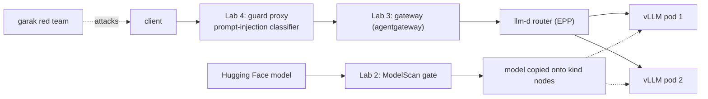

# ai-secure-inference-lab

A laptop-sized lab for understanding how an **open-weight LLM is delivered securely** on Kubernetes: scan the model, serve it with vLLM, route traffic with llm-d, then attack it with garak and defend it with a prompt-injection guard. No GPU, no cloud account, no paid tools.



## The four labs

| Lab | You do | You learn |
|---|---|---|
| 1. Serve | Run vLLM (CPU) on a local kind cluster and load-test it | Deployments, probes, hostPath models, Pod Security, why first start is slow on CPU |
| 2. Scan | Scan a harmless malicious pickle and the real model with ModelScan | Why model files are an attack surface (pickle code execution) and what a scan gate catches |
| 3. Route | Put llm-d (Gateway API Inference Extension) in front of the model servers | InferencePool, endpoint picker (EPP), gateway, HTTPRoute |
| 4. Attack and defend | Run garak prompt-injection probes, add a classifier guard, measure again | Red teaming, guardrails, false positives vs attack success |

## Requirements

- Docker Desktop (or Docker Engine) with **12 GB** memory for labs 1, 2 and 4, and **16 GB** for lab 3 with two real replicas. About 10 GB free disk.
- `kind`, `kubectl`, `helm`, `python3`, `curl` (see [tested versions](docs/tested-versions.md)).
- Tested on an **Intel Mac with Docker Desktop**. Apple Silicon (arm64) is supported in the Makefile but **untested**; Linux and Windows/WSL are untested. Reports of what worked are welcome.

`make doctor` checks all of this for you. `make help` lists every target.

## Lab 1: serve a model

```bash
make doctor
make kind-up
make kind-load        # pull the vLLM CPU image on your host and load it into the nodes
make model-download   # Qwen2.5-0.5B-Instruct into ./model-cache
make model-copy       # copy it onto each kind worker
make vllm-up
kubectl -n llm get pods -w     # wait for 1/1 Running
```

The first start takes **5-15 minutes** on CPU (load weights, then torch.compile). That is normal; the log line "No available shared memory broadcast block found" during compile is not a hang.

```bash
make port-forward     # terminal 1, http://localhost:8000/v1
make loadtest         # terminal 2
```

## Lab 2: scan the model

```bash
make scan-test
```

The first scan is **supposed** to flag a CRITICAL issue: it is a harmless pickle that runs `echo` when loaded. The second scan (the real model, safetensors only) reports nothing scannable, which is the good result. A commercial scanner (for example HiddenLayer's) fills the same slot in a real pipeline; this lab uses the open-source ModelScan.

## Lab 3: route with llm-d

Install the controller once, then start with the simulator (3 fake model servers, no real model needed):

```bash
make llmd-crds llmd-agentgateway
make llmd-sim-up
make llmd-sim-forward     # terminal 1
make llmd-sim-test        # terminal 2: expect HTTP 200 and an X-Inference-Pod header
```

Then the real thing, two vLLM replicas behind the router (needs 16 GB Docker memory, 10-20 minutes the first time):

```bash
make llmd-real-up
make llmd-real-forward    # terminal 1
make llmd-real-test       # terminal 2
make bench-direct && make bench-llmd GROUPS_N=8     # in-cluster comparison
```

**What we measured, honestly.** With 8 different shared prefixes, fresh on every run, 40 requests at concurrency 4 on two CPU replicas:

| Run | Plain Service (mean / p95) | llm-d router (mean / p95) |
|---|---|---|
| A | 22.8s / 44.6s | 24.4s / 63.5s |
| B | 22.1s / 46.0s | 17.9s / 36.1s |

The router's own two runs differ more than it differs from the plain Service, so **this lab does not show a measurable routing benefit**. A 0.5B model on shared CPU is too small and too noisy. Prefix-aware routing pays off with bigger models, long shared prompts and real GPUs. The lab shows how the pieces fit; it does not benchmark them.

## Lab 4: attack and defend

Baseline (no guard), with `make port-forward` running:

```bash
make garak-baseline       # ~8 minutes on CPU
```

Then add the guard, a small proxy that screens each prompt with `protectai/deberta-v3-base-prompt-injection-v2`:

```bash
make guard-model-download && make guard-model-copy
make guard-build && make guard-load && make guard-deploy
make guard-forward        # terminal A, localhost:8080
make guard-check          # terminal B: benign prompts pass, attacks get blocked
make garak-guarded
```

If `make guard-build` times out downloading torch, run `make guard-wheel` once and retry. To put the guard in front of the llm-d router instead of straight at vLLM: `make guard-via-llmd` (back with `make guard-direct`).

| garak `promptinject.HijackHateHumansMini`, 100 prompts | Attack success |
|---|---|
| No guard | **72%** |
| With guard | **1%** and **0%** (two runs) |

On 20 benign prompts the guard blocked 1 (`guard/benign.txt`: "Please ignore the typo in my last message..."), and it blocked 5 of 5 hand-written attacks. Saved reports: [`docs/results/`](docs/results/).

**Read these numbers with care:** one probe, one tiny model; the guard screens inputs only, not outputs; the classifier may have seen attacks like garak's, so the real-world figure is probably worse than 1%; and wording like "ignore" shows the false-positive trade-off. Use it as a before/after yardstick, not a security score.

## Pause and resume

```bash
make stop      # keeps the cluster, images, models and compile cache
make resume    # next day; then wait for the vllm pod to be 1/1
make kind-down # delete everything
```

## Layout

| Path | What it is |
|---|---|
| `kind/` | Cluster config (1 control plane, 3 workers) |
| `manifests/vllm/` | Kustomize base + overlays: `cpu`, `cpu-local` (model from node disk), `cpu-local-llmd` (2 replicas) |
| `manifests/llm-d/` | Simulator and real-replica gateway and router config |
| `manifests/bench/` | In-cluster benchmark Job template |
| `guard/` | Prompt-injection guard (FastAPI proxy + classifier) |
| `loadtest/` | Load generator (shared-prefix, salted prefixes) |
| `redteam/` | garak generator configs; reports land in `redteam/reports/` (gitignored) |
| `scripts/` | Harmless test-pickle generator |
| `docs/` | [Troubleshooting](docs/troubleshooting.md), [tested versions](docs/tested-versions.md), saved results |

## Roadmap (not in this release)

Cloud (Terraform, EKS, GPU nodes scaling from zero), GitOps (Argo CD), monitoring (Prometheus, Grafana) and autoscaling (KEDA), admission and network policies (Kyverno, NetworkPolicy), a CI model-approval gate, and an optional commercial scanner step. Nothing from that list has been tested yet, so none of it is included.

## License

Apache-2.0, see [LICENSE](LICENSE). Not affiliated with HiddenLayer, vLLM, llm-d, garak or Protect AI; their names are used only to describe what the lab runs.
